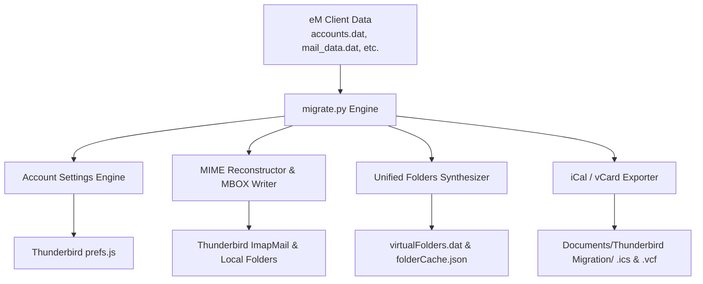

# eM Client to Mozilla Thunderbird Migrator

[](https://opensource.org/licenses/MIT)
[](https://www.python.org/downloads/)
[](#supported-platforms)
[](CONTRIBUTING.md)

A free, standalone, open-source tool to migrate **all Accounts (settings & credentials)**, **Emails (MBOX format with full attachments & read status)**, **Calendars (.ics)**, and **Contacts (.vcf)** from **eM Client** to **Mozilla Thunderbird**.

Commercial migration utilities typically charge \$40–\$80 and only perform clumsy partial exports. This tool performs the entire migration locally, offline, and in seconds—with **zero external pip dependencies**.

---

## ✨ Features

- **⚡ Zero Dependencies**: Pure Python 3 standard library. No `pip install` required.
- **🔄 Complete Account Migration**:
  - Automatically parses eM Client's `accounts.dat` (SQLite + JSON).
  - Configures incoming IMAP/POP3 servers, ports, and SSL/TLS encryption in Thunderbird's `prefs.js`.
  - Configures SMTP outgoing servers and identities.
  - Automatically enables modern **OAuth2** authentication for Microsoft (Outlook/Live/Hotmail) and Google (Gmail) accounts.
- **📬 Full Email & Folder Hierarchy Migration**:
  - Reconstructs complete RFC 822 MIME message trees directly from eM Client's local SQLite database (`LocalMailContents`), preserving nested multipart bodies and all attachments (PDFs, images, ZIPs, etc.).
  - Exports directly into Thunderbird's native **MBOX** format.
  - Preserves Read/Unread flags (`X-Mozilla-Status: 0001` vs `0000`).
  - Deploys mail stores into each account's storage directory (`ImapMail` / `Mail`) and `Local Folders`.
- **🗂️ Unified Folders Integration**:
  - Updates Thunderbird's `virtualFolders.dat` and `folderCache.json` so every migrated account automatically participates in **Unified Inbox**, **Unified Sent**, **Unified Trash**, and **Unified Junk/Spam**.
- **📅 Calendar Migration**:
  - Extracts all calendar events into a master iCalendar (`eMClient_All_Calendars.ics`) file and individual per-account `.ics` files.
- **📇 Contacts Migration**:
  - Exports all address books into a master vCard (`eMClient_All_Contacts.vcf`) file (names, emails, phones, organization, title).
- **🛡️ Safety & Backups**:
  - Automatically creates timestamped backups of `prefs.js` before making any changes.
  - Supports `--dry-run` to preview actions before applying them.

---

## 🚀 Quick Start

### 1. Close Thunderbird
Ensure Thunderbird is completely closed so its configuration files can be updated cleanly.

### 2. Run the Migrator
```bash
python migrate.py
```

The script will:
1. Auto-detect your eM Client data directory.
2. Auto-detect your active Thunderbird profile.
3. Back up your Thunderbird `prefs.js`.
4. Configure all your email accounts.
5. Reconstruct all historical emails into native MBOX stores.
6. Register all accounts into Unified Folders.
7. Export your calendars and contacts to your `Documents/Thunderbird Migration/` folder.

---

## 🛠️ CLI Options

```text
usage: migrate.py [-h] [--emclient-path EMCLIENT_PATH] [--tb-profile TB_PROFILE]
                  [--force] [--dry-run] [--accounts-only] [--mails-only]
                  [--calendar-only] [--contacts-only]

Migrate eM Client data to Mozilla Thunderbird

options:
  -h, --help            Show this help message and exit
  --emclient-path PATH  Path to eM Client data directory (default: auto-detect)
  --tb-profile PATH     Path to Thunderbird profile directory (default: auto-detect)
  --force               Automatically terminate running Thunderbird process
  --dry-run             Preview migration actions without modifying any files
  --accounts-only       Only migrate account configurations into prefs.js
  --mails-only          Only migrate emails into MBOX format
  --calendar-only       Only export calendar events to .ics
  --contacts-only       Only export contacts to .vcf
```

### Examples

**Simulate a migration without modifying any files:**
```bash
python migrate.py --dry-run
```

**Force close Thunderbird and run a full migration:**
```bash
python migrate.py --force
```

**Export only calendars and contacts:**
```bash
python migrate.py --calendar-only --contacts-only
```

---

## 📖 Importing Calendars & Contacts into Thunderbird

After running the script, your calendar and contact files are saved in:
`Documents/Thunderbird Migration/`

### To Import Calendar:
1. In Thunderbird, switch to the **Calendar** tab (or press `Ctrl+Shift+C`).
2. Go to **Events and Tasks** ➔ **Import...**
3. Select `eMClient_All_Calendars.ics` and choose your calendar.

### To Import Contacts:
1. In Thunderbird, open the **Address Book** (or press `Ctrl+Shift+B`).
2. Click **Tools** ➔ **Import**.
3. Choose **vCard file (.vcf)** and select `eMClient_All_Contacts.vcf`.

---

## 🏗️ How It Works



1. **eM Client Storage**: eM Client stores data across SQLite databases (`accounts.dat`, `mail_data.dat`, `mail_index.dat`, `event_data.dat`, `contact_index.dat`).
2. **MIME Reconstruction**: Email bodies and attachments in eM Client are split into MIME parts inside `LocalMailContents`. The migrator reassembles the boundary structures, body parts, and attachments into standard RFC 822 emails.
3. **MBOX Deployment**: Writes standard MboxRD format with `X-Mozilla-Status` headers directly into Thunderbird's profile.
4. **Unified Indexing**: Synthesizes the search scopes in `virtualFolders.dat` so Thunderbird's Unified Folders immediately display all accounts.

---

## 💻 Supported Platforms

- **Windows 10 / 11** (eM Client 7, 8, 9, 10, 11 beta)
- **macOS** (eM Client for Mac)
- Python 3.8, 3.9, 3.10, 3.11, 3.12, 3.13, 3.14+

---

## 📄 License

This project is licensed under the [MIT License](LICENSE). You are free to use, modify, and distribute it.
